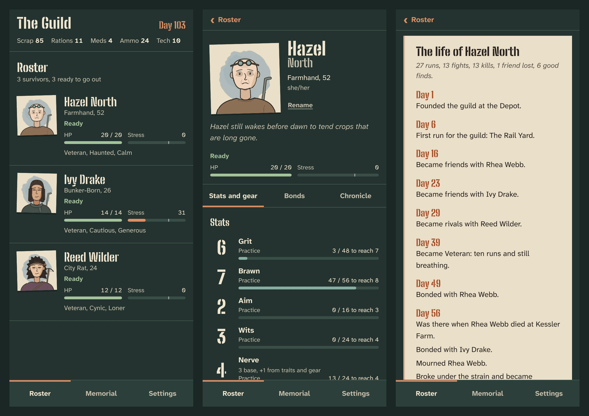
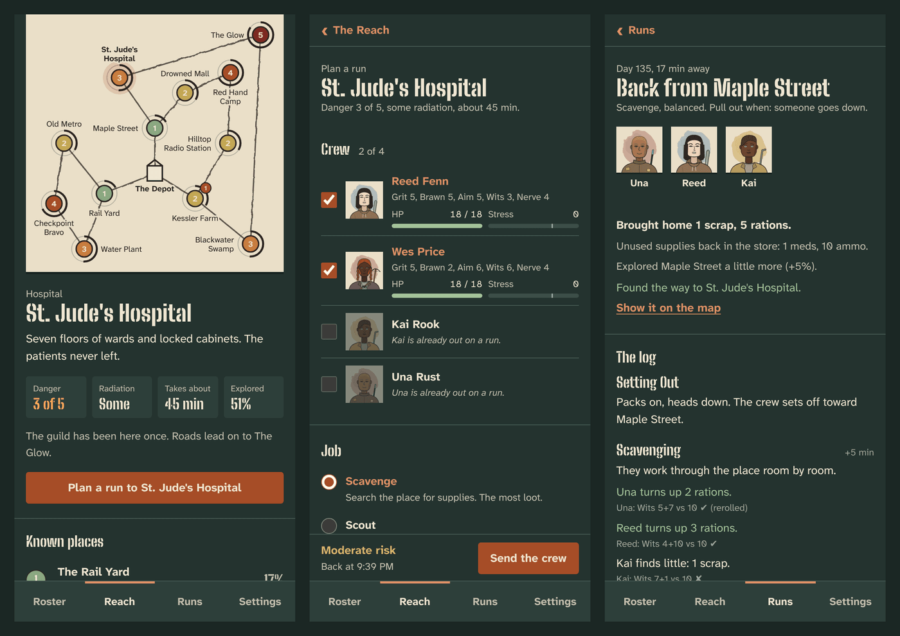
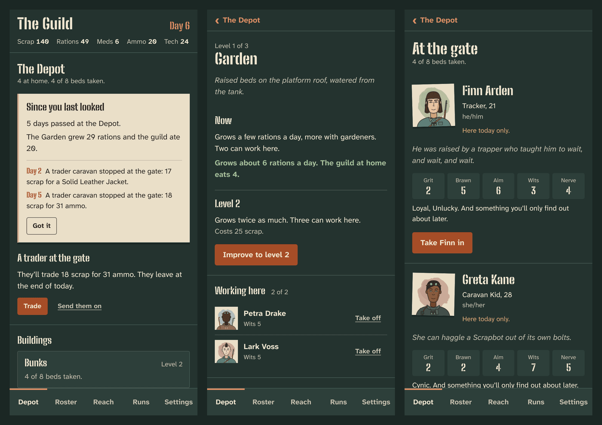
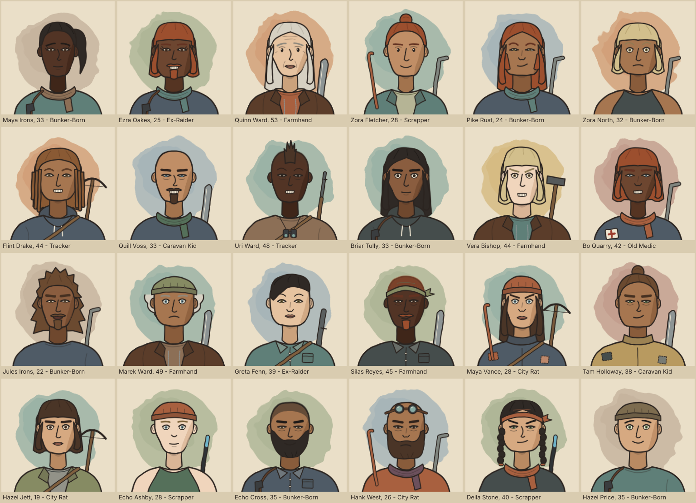
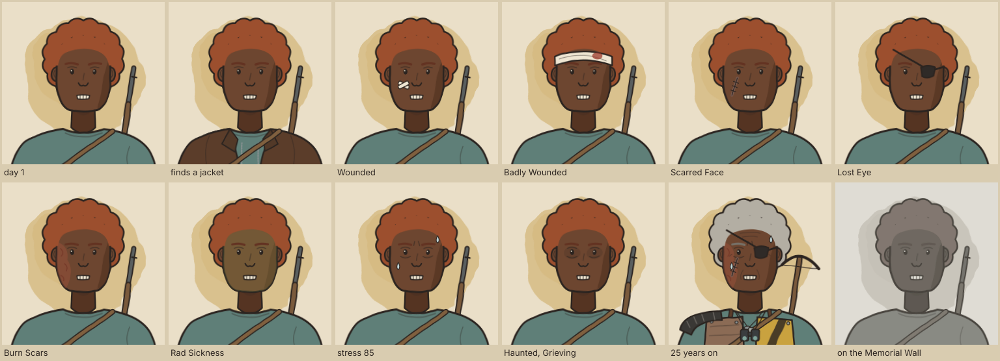

# The Guild

Run a scavenger guild out of a ruined rail depot, forty years after the Burn. Recruit drifters, gear them up, send crews into the Reach, and read what happened when they come back. Every survivor changes with what they live through: scars, traits, friendships, feuds, and occasionally a name on the Memorial Wall.

- Design: [`docs/DESIGN.md`](docs/DESIGN.md)
- Status: PRs 1–7 of the roadmap. The app has the Depot (buildings, posts, food, healing, raids, traders, recruits, the Workshop), the roster, survivor sheets, the Reach map, the run planner, crews out in real time, run reports and the Memorial Wall, and saves on the device. The Android build (PR 8) is next.









One survivor through everything that can happen to them:



## Development

Requires Node 22.18 or later.

```bash
npm install
npm run dev      # play in a browser; open the Network URL on a phone to try it there
npm run check    # typecheck + tests + build
npm run sample   # print a randomly generated guild
npm run career   # play a guild through 40 runs and watch its people change
npm run portraits # write a gallery of survivor portraits to out/portraits.html
```

Runs take real time (10 minutes to 2.5 hours). To test without waiting, turn on **Settings → Developer → Developer shortcuts**: a crew's run then has a button to skip ahead to their return. **Play ten runs** moves a new guild forward a month so there is history to look at.

Fonts: [Big Shoulders Stencil](https://fonts.google.com/specimen/Big+Shoulders+Stencil) and [Atkinson Hyperlegible Next](https://fonts.google.com/specimen/Atkinson+Hyperlegible+Next), both under the SIL Open Font License, bundled through Fontsource.
